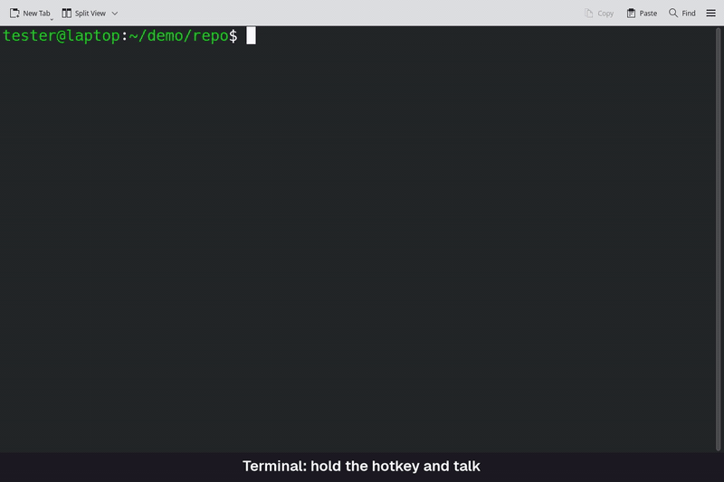

<div align="center">

<picture>
  <source media="(prefers-color-scheme: dark)" srcset="docs/brand/hush-lockup-dark.svg">
  
</picture>

**Local dictation for Linux.**<br>
Hold a key, talk, and your words appear wherever you're typing.

[](https://github.com/andymai/hush/actions/workflows/ci.yml)
[](https://github.com/andymai/hush/releases/latest)
[](https://github.com/andymai/hush/commits/main)
[](https://github.com/andymai/hush/blob/main/LICENSE)
[](https://www.rust-lang.org/)

**[Features](#features)** · **[Install](#install)** · **[Setup](#setup)** · **[Docs](#docs)** · **[Contributing](https://github.com/andymai/hush/blob/main/CONTRIBUTING.md)**

<br>



</div>

Hush runs OpenAI's Whisper models, or the opt-in NVIDIA Parakeet model, on your own computer, on the GPU through Vulkan when you have one. Audio stays on your computer unless you choose a cloud service for transcription.

The packages type through the kernel's input layer, so they work in terminals, browsers, editors, chat, VMs, games, and password fields, on any Wayland or X11 desktop. The Flatpak types through the desktop portals instead. It works on KDE Plasma 6 and GNOME 48 or later, and [Limits](#limits) says what differs.

## Features

### Dictation that stays out of your way

- **Hold to talk, or lock hands-free.** Hold `Right Alt` while you speak, or double-tap it to keep recording, then press once to stop. `Esc` discards a recording, and hands-free recording stops on its own after ten minutes. In the Flatpak, your desktop's shortcut settings hold these keys.
- **Long recordings in parts.** A hands-free recording transcribes in parts while you speak, cut at the pauses. When you stop, only the last part still needs transcription.
- **Speak at the tone.** Hush plays the start tone when the microphone first sends audio, not when you press the key. The tone tells you that Hush hears you.
- **Any key, any script.** `hush toggle`, `hush start`, `hush stop`, and `hush cancel` talk to the daemon, so a compositor keybind or a script can drive dictation.

### Text that fits the application

- **Tone by application.** Lowercase in terminals and editors, casual in chat, full sentences in mail and documents. In a terminal, a line break becomes a space, so dictated text cannot run a command.
- **Writing styles.** Give a style its own dictation key, set a default style for an application, or rewrite the selected text with a style.
- **Command Mode.** Hold the Command key (`Ctrl+Right Alt`, or your desktop's shortcut in the Flatpak), say what to do ("make this friendlier"), and release. Hush rewrites the selected text with a local or cloud language model, which gets text and never audio.
- **Cleaner text.** Voice commands such as "new line" and "scratch that", no filler words, and an optional LLM polish of every transcript.
- **Your own words.** Select a term that Hush misspells and run `hush learn`. From then on, Hush writes it your way.

### Every language and layout

- **Any language that Whisper knows.** Detect what you speak, or limit the detection to the languages that you use. Give each language its own key.
- **Every keyboard layout.** The packages type key by key through the XKB keymap of the active layout, with accents and Caps Lock. When a take has a character that no key types, such as an emoji, Hush pastes the take. The Flatpak types the characters on the first two levels of a keymap with one layout, and pastes accents through dead keys, AltGr characters, and emoji.

### Nothing lost

- **History.** Hush keeps the last 500 transcripts in a file that only you can read. The History page searches, copies, and fixes them, and it can keep the audio of each take.
- **No lost takes.** When a transcription fails, Hush keeps the audio for 7 days, and `hush recover` transcribes it later.

### At home on the desktop

- **A settings window.** `Ctrl+K` searches every setting, page, and action, and each change saves at once.
- **A panel icon.** It shows whether Hush is idle, recording, or working, and its menu has the actions of the hotkeys.
- **A doctor.** `hush doctor` checks each part of the setup and prints the one command that fixes each problem.

<picture>
  <source media="(prefers-color-scheme: dark)" srcset="docs/screenshots/settings/overview.png">
  
</picture>

The [feature guide](https://github.com/andymai/hush/blob/main/docs/features.md) has the details of each feature.

## Install

| Method | Command |
|---|---|
| Flatpak (KDE Plasma 6, GNOME 48 or later) | Open [the install file](https://andymai.github.io/hush/io.github.andymai.hush.flatpakref) with your software center, or run `flatpak install --from https://andymai.github.io/hush/io.github.andymai.hush.flatpakref`. See [INSTALL.md](https://github.com/andymai/hush/blob/main/INSTALL.md#flatpak) |
| Fedora (COPR) | `sudo dnf copr enable veroz/hush && sudo dnf install hush` |
| Release files | Download the `.deb`, `.rpm`, `AppImage`, or tarball from the [latest release](https://github.com/andymai/hush/releases/latest), and see [INSTALL.md](https://github.com/andymai/hush/blob/main/INSTALL.md#release-files) |
| Install script (Ubuntu, Debian, Fedora, openSUSE, Arch, and most others) | `curl -fsSL https://raw.githubusercontent.com/andymai/hush/main/install.sh \| sh` |
| NixOS (flake) | `nix profile install github:andymai/hush`, and see [INSTALL.md](https://github.com/andymai/hush/blob/main/INSTALL.md#nix-and-nixos) for the system module |
| Source | `make install`, and see [INSTALL.md](https://github.com/andymai/hush/blob/main/INSTALL.md#build) |

The script detects your distribution and checks the checksum of the download. It also checks the [build provenance](https://github.com/andymai/hush/blob/main/INSTALL.md#verify-a-download) when your system has GitHub CLI 2.49 or later and you logged in to it. Debian and Ubuntu get the `.deb`, and Fedora, RHEL, and openSUSE get the `.rpm`. Both install through your package manager, so removal is a normal `apt remove hush` or `dnf remove hush`. Every other distribution, Arch included, gets the tarball under `~/.local`.

The prebuilt packages are for x86-64 Linux. They need only your usual graphics driver: NVIDIA, AMD, and Intel all work through Vulkan, with a CPU fallback everywhere else.

## Setup

`hush setup` opens a window that sets Hush up one step at a time, from keyboard access and a model to a first dictation and privacy. The first `hush settings` on a new install opens the same steps, and so does the notification that the daemon sends once.

With the Flatpak, open Hush from your app menu, and the window takes you through the steps. Your desktop asks for keyboard access at the first dictation. Hush proposes a key only for dictation, so set the Cancel and Command keys in your desktop's shortcut settings. In a terminal, run each command as `flatpak run io.github.andymai.hush <command>`, for example `flatpak run io.github.andymai.hush doctor`.

With a package, in a terminal:

```bash
hush setup permissions        # one polkit prompt: keyboard and uinput access, no logout
hush models download base     # ~147 MB speech model
hush daemon start             # runs in the background
```

Hold the hotkey, speak, release. Done.

`hush setup init` asks for the GPU, the model, and the hotkey, and writes `~/.config/hush/config.toml`. The model defaults to the model that suits your hardware, which the Speech page of `hush settings` also names. `hush setup init --defaults` writes base without a prompt. `hush install --autostart` starts the daemon at login.

## Scope

Hush deliberately does not:

- **Send audio without asking.** Transcription runs on your machine. Groq, OpenAI, and an OpenAI-compatible server are an explicit choice (`transcription.backend`), and Hush never falls back to them on its own. The `openai-compatible` backend sends the audio to the URL that you set in `transcription.server_url`. Otherwise the network carries the one-time model download and the text for the LLM that you use. If you turn on the update check, it also carries a daily request for the newest release number.
- **Act as a voice assistant.** It types what you say. It does not answer questions, run commands, or wake on a phrase.
- **Run on macOS or Windows.** Linux-only, by design. It depends on Linux input (`/dev/uinput` and evdev, or the desktop portals in the Flatpak) and Linux window protocols.
- **Stream partial words.** It types the text when the recording stops, not live as you speak, also when it transcribes a hands-free recording in parts.
- **Replace your editor's dictation UI.** There is no correction overlay; text goes straight to the cursor. A fix on the History page changes only the copy in the history.

## Limits

Some limits come from where Hush runs:

- **wlroots desktops need a package.** Sway, Hyprland, and other wlroots desktops have no RemoteDesktop portal, so the Flatpak cannot type there.
- **The Flatpak pastes some characters.** It pastes accents through dead keys, AltGr characters, and emoji instead of typing them. With two or more layouts, it cannot tell which one is active, so it also pastes quotes and accents, and on KDE Plasma also digits and punctuation.
- **x86-64 only, for now.** The prebuilt packages and the Flatpak are x86-64. Other CPUs might build from source, but nobody has tested that.
- **A model download first.** The base model is about 147 MB, and the larger models are more.

## Docs

- [Features](https://github.com/andymai/hush/blob/main/docs/features.md): each feature in detail.
- [Commands](https://github.com/andymai/hush/blob/main/docs/commands.md): every command, the exit codes and JSON output for scripts, and a Waybar module.
- [Configuration](https://github.com/andymai/hush/blob/main/docs/configuration.md): every key of `config.toml`, how to move your setup, and the transcript hook.
- [Models](https://github.com/andymai/hush/blob/main/docs/models.md): the sizes, the opt-in Parakeet model, and the helper models with their licenses.
- [Flatpak and desktop portals](https://github.com/andymai/hush/blob/main/docs/portals.md): what works in a sandbox, and on which desktops.
- [Troubleshooting](https://github.com/andymai/hush/blob/main/docs/troubleshooting.md): the microphone, keyboard access, and the GPU.
- [Privacy and security](https://github.com/andymai/hush/blob/main/docs/privacy.md): what goes over the network, and when Hush writes audio to disk.
- [INSTALL.md](https://github.com/andymai/hush/blob/main/INSTALL.md): release files, download checks, Nix, Flatpak builds, and builds from source.

## Contributing

See [CONTRIBUTING.md](https://github.com/andymai/hush/blob/main/CONTRIBUTING.md) and the [Code of Conduct](https://github.com/andymai/hush/blob/main/CODE_OF_CONDUCT.md). Hush is MIT licensed and runs its speech models through transcribe.cpp and its [transcribe-cpp](https://crates.io/crates/transcribe-cpp) bindings, on [ggml](https://github.com/ggml-org/ggml). Release notes live in [CHANGELOG.md](https://github.com/andymai/hush/blob/main/CHANGELOG.md). If Hush is useful to you, a star on GitHub helps other people find it.

## License

[MIT](https://github.com/andymai/hush/blob/main/LICENSE).

The settings window embeds the [Geist and Geist Mono](https://github.com/vercel/geist-font) fonts under the SIL Open Font License 1.1 ([OFL.txt](https://github.com/andymai/hush/blob/main/src/gui/fonts/OFL.txt)). It also embeds icons from [Lucide](https://lucide.dev) under the ISC License ([LICENSE-lucide.txt](https://github.com/andymai/hush/blob/main/src/gui/fonts/LICENSE-lucide.txt)).
